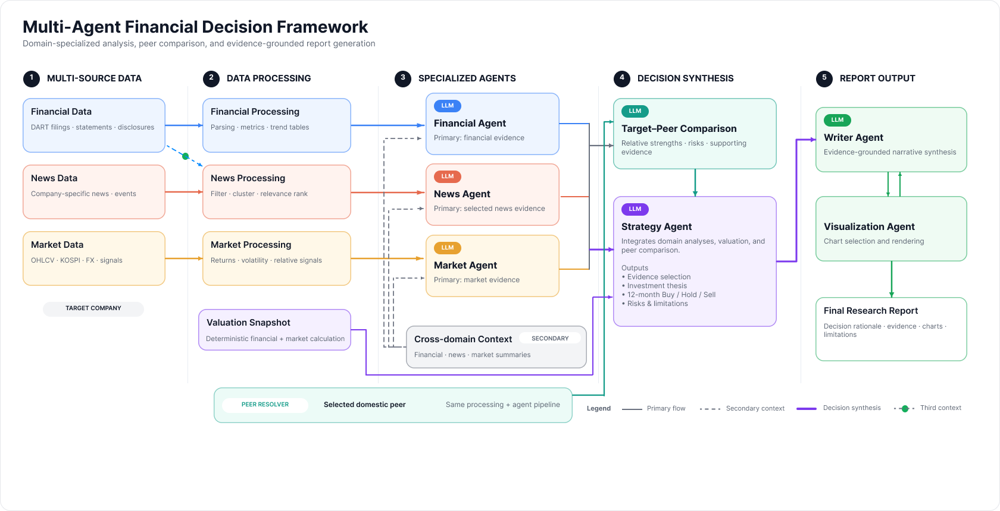

# Beyond Data Silos: Cross-Domain Context and Peer Analysis for Multi-Agent Financial Research

재무공시·기업 뉴스·시장자료와 비교기업 분석을 결합해 투자판단과 리서치 보고서를 생성하는 멀티에이전트 프레임워크의 최종 구현이다.

이 저장소의 `main`에는 최종 코드 한 버전, 실행 설정 예시, 설명 문서와 테스트만 포함한다. 수집 데이터, 실제 애널리스트 PDF, 생성 보고서, 실험 결과, 실행 로그와 API 키는 포함하지 않는다. 과거 개발 이력이나 이전 구현도 포함하지 않는다. 기존 논문 실험을 동결 입력으로 재현하려면 원자료와 평가 자료를 별도로 준비해야 한다.

생성 보고서는 연구와 정보 제공을 위한 자료이며 투자 자문이나 매매 권유가 아니다.

## 분석 구조



1. OpenDART 정기공시에서 재무제표·사업정보·주식 수를 수집하고 지표를 계산한다.
2. 기준일 이전 1년의 뉴스에서 기업 관련성을 확인하고 같은 주의 유사 기사를 사건으로 통합한다.
3. 대표기사와 공시 내용의 관련도에 따라 주별 상위 사건을 선정한다. 선정 기사 전체는 뉴스 분석에, 같은 사건의 월별 요약은 재무·시장 분석의 보조자료로 제공한다.
4. 재무·뉴스·시장 Agent가 주요 근거와 다른 영역의 보조자료를 구분해 분석한다. 대상기업과 비교기업에 같은 절차를 적용한다.
5. 비교 분석과 Strategy Agent가 근거를 통합해 향후 12개월의 Buy·Hold·Sell 의견, 전망과 위험을 작성한다.
6. Visualization Agent가 LLM 호출 없이 차트를 생성하고 Writer Agent가 본문과 결합해 HTML 보고서를 작성한다.

분석 기간과 근거 전달 방식은 [12개월 분석 설계](docs/annual_analysis.md), [뉴스 입력 구조](docs/news_article_only.md), [공시 관련도 산정](docs/news_section_weighting.md)을 참고한다.

## 설치

Python 3.10 이상을 사용한다.

```bash
git clone https://github.com/TaeHyoK/Beyond-Data-Silos.git
cd Beyond-Data-Silos
python -m venv .venv
source .venv/bin/activate
python -m pip install --upgrade pip
python -m pip install -e .
cp configs/.env.example configs/.env
```

개인 `OPENAI_API_KEY`와 `DART_API_KEY`를 `configs/.env`에 설정한다. 실제 키를 Git에 추가하지 않는다.

테스트에는 `python -m pip install -e ".[dev]"`, PDF 본문 추출과 BERTScore 평가에는 `python -m pip install -e ".[eval]"`로 추가 의존성을 설치한다.

## 실행

다음은 현대모비스의 2025년 10월 31일 장 시작 전 시점을 분석하는 예시다.

```bash
financial-report --company-name 현대모비스 --selected-date 20251031 --news-window 1y --decision-horizon-profile annual --llm-model gpt-5.4 --news-summary-model gpt-5.6-luna --no-progress
```

기준일 전에 이용 가능한 공시와 전일까지의 뉴스·시장자료를 사용한다. 월별 뉴스 요약과 분석 모델은 위 옵션으로 지정하며 모델과 입력을 실행 명세에 기록한다. API를 호출하는 생성 단계에는 비용이 발생한다.

`--peer-stock-code`로 비교기업을 지정하고 `--output-root`로 산출물 저장 위치를 변경할 수 있다. `--dry-run`은 실행 계획과 기업 식별을 확인하는 옵션이다. 전체 옵션은 `financial-report --help`로 확인한다.

기본 산출물은 `Output_total/{company_name}/`에 저장된다. 최종 HTML은 `report_{company_name}.html`이며 각 분석 단계의 파일과 실행 명세는 그 아래에 저장된다. 새로 생성된 산출물은 Git에서 제외한다.

## 코드 구성

```text
src/
├── Agent_Team/
│   ├── Financial_Agent/       # 공시 수집·재무 분석
│   ├── News_Agent/            # 뉴스 수집·사건 통합·분석
│   ├── YFinance_Agent/        # 시장자료·가치평가
│   ├── Competitor_Agent/      # 비교기업 선정·비교 분석
│   ├── Strategy_Agent/        # 투자판단·근거·위험
│   ├── Unified_Agent/         # One-team 조건의 통합 분석
│   ├── Visualization_Agent/   # 차트 생성
│   └── Writer_Agent/          # HTML 보고서 작성
├── orchestration/            # 파이프라인 실행·산출물 관리
└── shared/                   # 공통 근거 계약·모델 호출·유틸리티
ablation/                     # 구성요소 제거 실험의 실행·평가 코드
configs/                      # 입력·환경변수 설정 예시
docs/                         # 설계 설명과 프레임워크 그림
scripts/                      # 점검 유틸리티
tests/                        # 회귀 테스트
```

## 실험 실행·평가

Full, Random News, No-subdata, No-peer, One-team과 BERTScore·LLM 쌍대비교 평가 코드는 [`ablation/`](ablation/README.md)에 모았다. [실험 설정과 재현 절차](ablation/docs/ABLATION.md)를 참고한다.

원자료·참조 PDF·동결 입력·평가 응답은 저장소에 없다. 최종 코드로 새로 생성한 결과를 기존 논문 결과와 동일하다고 간주하지 않으며, 실행 버전·입력·모델과 결과를 함께 기록해야 한다. 유료 Judge 실행에는 별도 확인 옵션이 필요하다.

```bash
python ablation/run_config/final_report_llm_judge.py --help
python ablation/run_config/no_peer_target_llm_judge.py --help
PYTHONPATH=src:ablation python ablation/run_config/rerun_ablation.py --help
python -m pytest -q
```

`--help`와 테스트는 유료 모델을 호출하지 않는다.

## 적용 범위

국내 비금융 상장기업의 정기공시 분석을 중심으로 구현했다. 비교기업 한 곳과의 차이는 업종 전체의 평균이나 순위를 뜻하지 않는다. 수집 결과는 외부 사이트와 수집 시점에 영향을 받으며, 모델 응답은 같은 입력에서도 달라질 수 있다. 보고서 품질 평가를 투자등급 예측 정확도나 사후 투자수익률 검증으로 해석하지 않는다.

## 라이선스

코드와 문서는 [MIT 라이선스](LICENSE)를 따른다. 실제 애널리스트 보고서 등 외부 자료의 권리는 각 권리자에게 있다.
